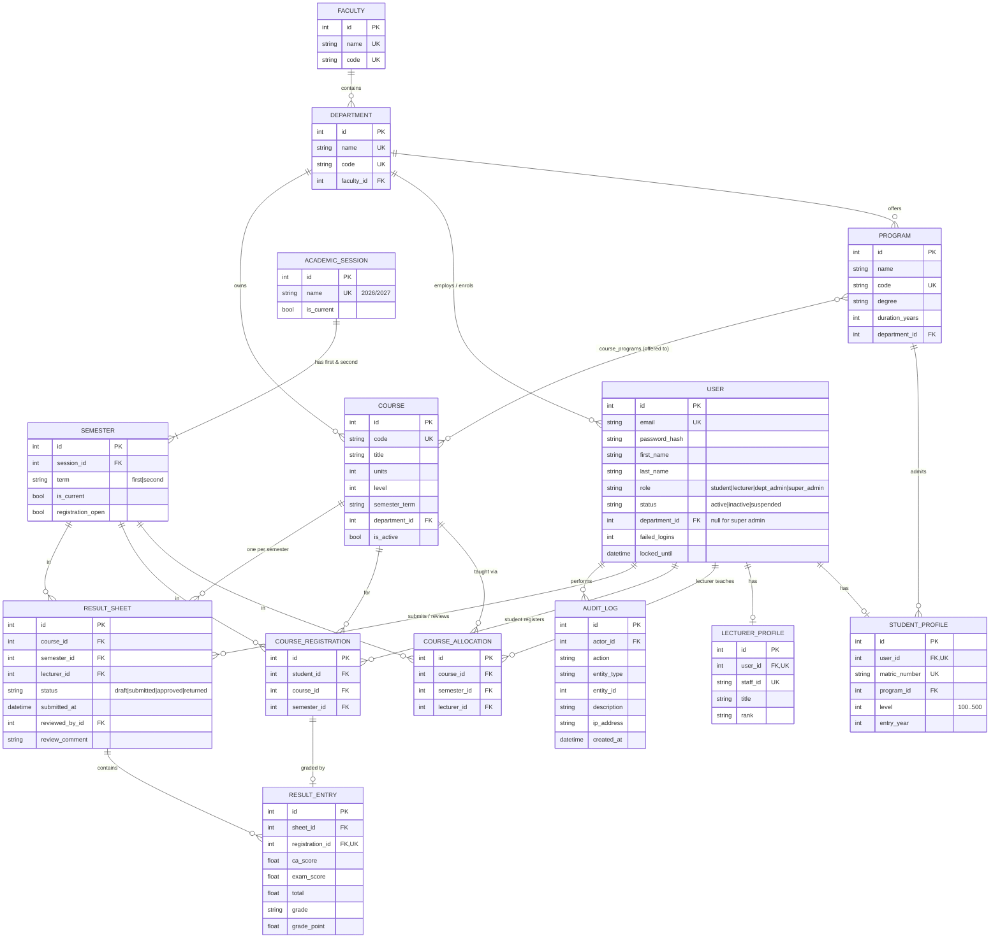

# UEMP — Technical Documentation

This document explains **how the portal is built and why**: the architecture, the database, the permission logic, the security measures and the key technical decisions. It is written to be read by someone new to the project.

---

## 1. Technology stack and why it was chosen

| Choice | Reason |
|---|---|
| **Python 3.12 + Flask 3** | Small, explicit framework. Every part (routes, auth, forms) is visible in our own code, which makes the permission logic easy to explain and audit. |
| **SQLAlchemy 2 (ORM)** | Database relationships are defined in Python classes. The same code runs on SQLite (development) and PostgreSQL (production) by changing one environment variable. |
| **Flask-Login** | Proven session management: signed cookies, "strong" session protection, automatic logout of deactivated users. |
| **Flask-WTF / WTForms** | Server-side form validation and CSRF tokens on every form. |
| **Jinja templates + Bootstrap 5** | Server-rendered pages: fast, accessible, work without a JavaScript build step, responsive on phones. JavaScript is used only for convenience (live grade preview, unit counter), never for security. |
| **htmx 2 (self-hosted, `static/vendor/htmx.min.js`)** | Makes the portal feel like a single-page app with no extra code: `hx-boost` on `<body>` turns every link and form into a background request, and only the `#app-main` panel is swapped. The sidebar, CSS and scripts stay loaded, the address bar and Back button still work, and without JavaScript the same links and forms work as normal pages. Downloads (`hx-boost="false"`) and print pages (`target="_blank"`) are excluded. |
| **pytest** | 239 automated tests for rules, permissions and workflows, plus 15 browser tests. |

A single-page app (React + API) was considered. For a 72-hour MVP, server-rendered pages give the same functionality with far less code and a smaller attack surface. Because all business rules live in the **service layer** (see §2), a JSON API for a future mobile app can be added later by calling the same services.

---

## 2. Architecture

The code is organised in **layers**. Each layer has one job and only talks to the layer below it.

```
 Browser
   │  HTTP (HTML forms, CSRF token)
   ▼
┌──────────────────────────────────────────────────────────────────────┐
│ Blueprints (uemp/blueprints/*)            "the web pages"             │
│   auth · main · student · lecturer · admin · superadmin               │
│   Read the form → call a service → show the result.                   │
├──────────────────────────────────────────────────────────────────────┤
│ Security (uemp/security/*)                "who may do what"           │
│   permissions.py  role → permissions table (RBAC)                     │
│   decorators.py   @permission_required, protect_blueprint             │
│   scope.py        which DEPARTMENT's data an admin may touch          │
├──────────────────────────────────────────────────────────────────────┤
│ Services (uemp/services/*)                "the business rules"        │
│   registration · results · grading · accounts · catalogue ·          │
│   academic · reports · audit                                          │
├──────────────────────────────────────────────────────────────────────┤
│ Models (uemp/models/*)                    "the database tables"       │
│   SQLAlchemy classes + database constraints                           │
└──────────────────────────────────────────────────────────────────────┘
   │
   ▼
 SQLite (dev) / PostgreSQL (prod)
```

**Why layers?**
- **Rules are written once.** "A student cannot register the same course twice" lives in `services/registration.py`. Every page, test and future API uses that same function.
- **Routes stay thin and readable.** A route is usually 5–15 lines.
- **Easy to test.** Services can be tested without a browser.

### Request lifecycle (example: a lecturer submits results)

1. Browser sends `POST /lecturer/courses/12/scores` with the CSRF token.
2. `CSRFProtect` checks the token → otherwise **400**.
3. `protect_blueprint(lecturer)` checks the user is logged in and has `lecturer.portal` → otherwise **login page / 403**.
4. The route loads allocation 12 and confirms it belongs to **this** lecturer → otherwise **403**.
5. The route calls `results.save_scores(sheet, scores, lecturer, submit=True)`. The service validates every score, computes totals/grades, checks every student has both scores, sets status `SUBMITTED` and writes audit entries.
6. `web.attempt()` commits the transaction. If any rule failed, **everything is rolled back** and the reason is shown to the user.

### Folder map

```
uemp/
  __init__.py      app factory: config, extensions, blueprints, error pages, security headers
  extensions.py    db, login_manager, csrf (created once, attached in the factory)
  models/          enums, academic, user, course, result, audit
  security/        permissions, decorators, scope
  services/        registration, results, grading, accounts, catalogue, academic, reports, audit, errors
  blueprints/      auth, main, student, lecturer, admin (shared by both admin roles), superadmin
  templates/       base layout, reusable macros, one folder per area, printable layouts
  navigation.py    sidebar menu built from permissions
  web.py           helpers: attempt() (commit/rollback), CSV export, semester picker
  seed.py, cli.py  demo data and command-line tools
```

---

## 3. Database design

### Entity-relationship diagram



### Key design decisions

| Decision | Why |
|---|---|
| **One `users` table + role-specific profile tables** | Login, password and role live in one place. Students and lecturers each get their own profile table so their fields can grow independently. |
| **`course_programs` many-to-many** | A course can serve several programmes (e.g. MTH 101 for Computer Science *and* Mathematics). The owning department still controls the course. |
| **`CourseAllocation` per semester** | "Who teaches CSC 201" changes each semester; history is kept. |
| **`ResultSheet` per (course, semester)** | Approval happens for a whole course at once. Putting the status on the sheet makes "students only see approved results" a single, reliable check. |
| **`ResultEntry` linked 1-to-1 to `CourseRegistration`** | A result can only exist for a student who actually registered. It is impossible to grade someone who isn't on the class list. |
| **Statuses stored as text with Python enums** | Readable in the database and protected from typos in code. |
| **UTC timestamps on every table** (`created_at`, `updated_at`) | Traceability, and no time-zone confusion. |

### Duplicate prevention — enforced twice

| Rule | Database constraint | Friendly service check |
|---|---|---|
| Same course twice in a semester | `UNIQUE(student_id, course_id, semester_id)` | `register_courses()` lists the duplicates |
| One lecturer per course per semester | `UNIQUE(course_id, semester_id)` on allocations | `allocate_course()` replaces / refuses |
| One result sheet per course per semester | `UNIQUE(course_id, semester_id)` on sheets | `open_sheet()` reuses the existing one |
| One result per registration | `UNIQUE(registration_id)` on entries | — |
| Unique email, matric no., staff ID, course/programme/department codes | `UNIQUE` columns | `accounts` / `catalogue` services |

The service checks give clear messages; the database constraints are the safety net if two requests arrive at the same moment. `web.attempt()` turns any database `IntegrityError` into a friendly message.

---

## 4. Permission logic (RBAC)

Access is checked in **three layers**. All three run on the server.

### Layer 1 — Permissions per role (`security/permissions.py`)

Every action has a permission name. Each role gets a set of permissions:

| Permission | Student | Lecturer | Dept Admin | Super Admin |
|---|:-:|:-:|:-:|:-:|
| Student portal (own profile, courses, results) | ✔ | | | |
| Lecturer portal, enter/submit scores | | ✔ | | |
| Manage students, lecturers, programmes, courses, allocations | | | ✔ *own dept* | ✔ *all* |
| View registrations, review results, reports | | | ✔ *own dept* | ✔ *all* |
| University dashboard, faculties, departments, sessions | | | | ✔ |
| Manage every account, change roles, read audit trail | | | | ✔ |
| Activate / deactivate / suspend / unsuspend / unlock accounts | | | | ✔ |
| Delete records (faculties, departments, programmes, people, sessions, semesters) | | | | ✔ |
| Edit or remove a student's course registration | | | | ✔ |

The **Roles & Permissions** page in the Super Admin area renders this table directly from the code, so the documentation can never disagree with what is enforced.

Routes are guarded with:
- `protect_blueprint(bp, Perm.X)` — protects **every** route in an area (student, lecturer, admin, superadmin), including routes added in future.
- `@permission_required(Perm.X)` — for individual actions inside the shared admin area.

### Layer 2 — Department scope (`security/scope.py`)

Department admins and the Super Admin share the same admin pages. The difference is *which records* they can reach:

```
allowed_department_ids(user)
    Super Admin       -> None   (meaning: every department)
    Department Admin  -> [their department id]
    anyone else       -> []     (nothing)
```

- Every admin **list** query passes through `limit_to(...)` / `scoped(...)`, so other departments' rows never load.
- Every admin action on **one record** calls `ensure_department_access(record.department_id)` → **403** if out of scope.
- Services re-check scope (e.g. `results.approve()` refuses a reviewer from another department) — defence in depth if a route is ever written incorrectly.

### Layer 3 — Ownership rules (in the services)

| Rule from the brief | Where it is enforced |
|---|---|
| Students cannot register other students / see others' data | Student routes only ever use `current_user`; IDs from the browser are checked to belong to them (`drop_course`). |
| Students can only view **approved** results | `grading.approved_results_for()` filters on `ResultSheet.status == APPROVED`. |
| Students can only register eligible courses | `registration.eligible_courses()` (programme, level, semester, active), re-checked on submit. |
| Lecturers can only manage courses assigned to them | `results.get_allocation()` and `save_scores()` check the allocation's lecturer. |
| Submitted results cannot be edited without authorised reopening | `save_scores()` only works on DRAFT/RETURNED; only `reopen()` (department admin) moves APPROVED back. |
| Lecturers cannot approve their own results | `_check_reviewer()` refuses when `sheet.lecturer_id == reviewer.id`. |
| Results must be submitted before approval | `approve()` / `reject()` require status SUBMITTED. |
| Dept admins cannot touch super-admin functions or other departments | Layer 1 (no permission) + Layer 2 (scope). They also cannot suspend or reset administrator accounts. |

### Result status workflow

```
 DRAFT ──submit──▶ SUBMITTED ──approve──▶ APPROVED  (visible to students)
   ▲                   │                     │
   │                reject (comment         reopen (reason
   │                required)                required)
   │                   ▼                     │
   └───── edit ──── RETURNED ◀───────────────┘
```

**Correction requests.** Once results are SUBMITTED or APPROVED the lecturer cannot edit them. The **Request correction** tab lets them ask, with a reason (`results.request_correction`). The department sees the request in **Result Approval → Correction requested** (from any semester) and on its dashboard, and either:
- **allows it** (`grant_correction`): the sheet goes to RETURNED, so the lecturer can edit and resubmit, and an approved sheet is hidden from students again; or
- **refuses it** (`decline_correction`): a reason is required, and the sheet stays as it was.

A sheet cannot be approved while a request is waiting.

### Academic calendar

Session → semesters. A semester moves through **Make current → Open registration → Close registration → Mark completed**. A completed semester can never be made current or have its registration reopened, unless the Super Admin explicitly **Reopens** it. A session can be marked completed once all its semesters are. Sessions and semesters can be edited at any time. They can be deleted only while nothing (registrations, allocations, result sheets) has been recorded in them.

### Deleting records safely

Deletes are Super Admin only and refuse anything that would break history:
- faculties with departments;
- departments with programmes, courses or people;
- programmes with students;
- staff named on allocations or result sheets (deactivate them instead).

Deleting a student also removes their registrations and scores. Audit entries are never deleted: each keeps a copy of the person's name and role (`actor_name`, `actor_role`).

### Database upgrades

`uemp/schema.py` compares the models with the live database on startup and adds any missing columns (`ALTER TABLE … ADD COLUMN`). A database created by an earlier version, such as an existing Neon database, upgrades itself on the next deploy without losing data. New columns are therefore always nullable or have a server default.

---

## 5. Security measures

| Area | Measure |
|---|---|
| Passwords | Hashed with **scrypt** (Werkzeug). Minimum 8 characters with letters and numbers. |
| Brute force | Account locks for 15 minutes after 5 wrong passwords. Same error for "unknown email" and "wrong password" (no account discovery). |
| Sessions | Signed, `HttpOnly`, `SameSite=Lax` cookies; `Secure` in production; 30-minute idle timeout; "strong" session protection; session cleared on login (prevents session fixation). |
| Deactivated users | `user_loader` returns nothing for non-active accounts, so a suspended user is logged out on their next click. |
| CSRF | Token on every form (Flask-WTF). Logout is POST-only. |
| Open redirects | `?next=` after login only accepts paths on this site. |
| Injection | All database access through SQLAlchemy with bound parameters. Jinja auto-escapes HTML output (XSS protection). |
| Browser headers | `X-Frame-Options: DENY`, `X-Content-Type-Options: nosniff`, `Referrer-Policy`, `Cache-Control: no-store` for private pages. |
| Secrets | `SECRET_KEY` and `DATABASE_URL` from the environment; the app refuses to start in production with the default key. |
| Data integrity | Each request is one transaction: on any rule failure everything is rolled back. Audit rows are written in the same transaction as the change they describe. |
| Audit trail | Logins, registrations, score modifications (old → new values), submissions, approvals, rejections, reopenings, account/role/status changes, structure changes — with actor, time and IP. Audit rows are never edited. |
| Error pages | Friendly 400/403/404/500 pages; no stack traces in production. |

---

## 6. GPA calculation

Defined in `services/grading.py`, scale configured in `config.py → GRADING_SCALE`.

```
GPA  = Σ(units × grade point) ÷ Σ(units)    — one semester, approved results only
CGPA = same formula over every approved result
```
Example: CSC 201 (3 units, A = 5) and MTH 201 (2 units, C = 3) → (15 + 6) ÷ 5 = **4.20**.

Totals and grades are always computed on the **server** when scores are saved. The live preview in the browser is only a convenience.

---

## 7. Scaling path

The MVP is deliberately simple, but each of these is a small change rather than a rewrite:

| Need | How |
|---|---|
| More users | Run more gunicorn workers / instances (the app is stateless; sessions live in signed cookies). Use PostgreSQL (already supported). The main foreign keys and common filter columns are already indexed. |
| Schema changes | Add **Flask-Migrate (Alembic)** for versioned migrations. |
| Mobile app / integrations | Add an `api` blueprint returning JSON that calls the **same services**. |
| New role (e.g. Exams Officer) | Add it to `Role` and give it permissions in `ROLE_PERMISSIONS`; scope rules in `scope.py`. |
| Fee payments, hostels, notifications | New service + blueprint each; existing code does not change. Notifications could hook into the same places that write audit entries. |
| Heavy reports | Move report queries to a read replica or a background job; the `reports` service is already separated. |
| Rate limiting at scale | Add Flask-Limiter with Redis in front of `/login`. |

---

## 8. Testing

`pytest` runs 239 tests, each against a fresh database seeded with the demo data. They pass on SQLite and on PostgreSQL (`TEST_DATABASE_URL`). A further 15 browser tests live in `tests/e2e`. The brief-by-brief map is in [TEST_REPORT.md](TEST_REPORT.md).

Core test files:

| File | Covers |
|---|---|
| `test_grading.py` | Every grade boundary, weighted GPA, classification, approved-only history |
| `test_auth.py` | Role redirects, wrong password, lockout, suspended users (including live sessions), POST-only logout, open-redirect protection, security headers |
| `test_rbac.py` | Every role blocked from other areas; department admins blocked from other departments' students, courses and results |
| `test_registration.py` | Eligibility, duplicate prevention, tampered course IDs, unit limit, closed registration, dropping own vs others' courses |
| `test_results.py` | Draft saving, score validation, missing scores, locking, approval/publication, rejection with feedback, full correct-and-resubmit cycle with audit of changed scores, reopening |
| `test_superadmin.py` | Faculties, departments, sessions, current semester, admin accounts, role changes, status changes, scoped student creation, duplicate matric numbers, allocation |
