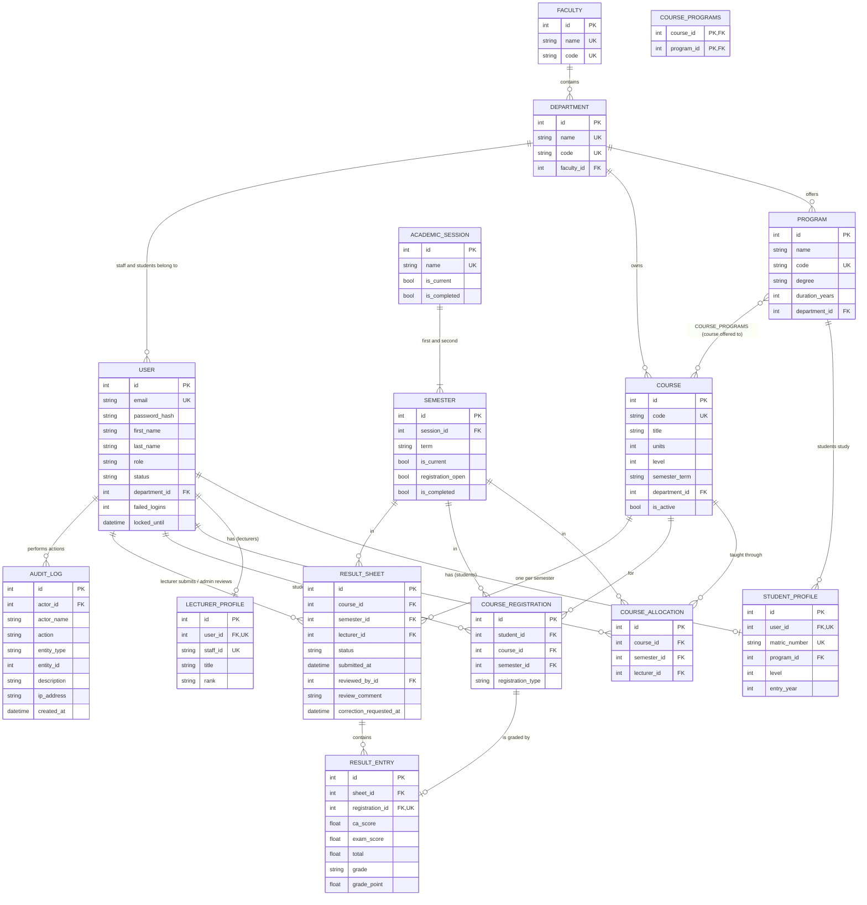

# UEMP — Database design

This document describes the full database of the University Education Management Portal:
- the ER diagram;
- every table, with its columns and keys;
- the relationships between tables;
- the rules the database itself enforces;
- how the design supports the submitted **Lecturer Result Submission** workflow.

| | |
|---|---|
| **Database** | PostgreSQL in production (Neon); SQLite for local development. The same schema is used for both. |
| **Access layer** | SQLAlchemy 2 ORM. The models are in `uemp/models/`. |
| **Tables** | 14 (13 entity tables plus 1 link table) |
| **Created by** | `flask --app run init-db` or `flask --app run seed`. Missing columns are added on start-up by `uemp/schema.py`. |

---

## 1. Entity-relationship diagram

GitHub draws this diagram automatically. `PK` = primary key, `FK` = foreign key, `UK` = unique.

The tables fall into five groups:

| Group | Tables | Purpose |
|---|---|---|
| University structure | `faculties`, `departments`, `programs`, `course_programs` | Faculties contain departments; departments offer programmes and own courses |
| People | `users`, `student_profiles`, `lecturer_profiles` | One account per person, plus extra details for students and lecturers |
| Academic calendar | `academic_sessions`, `semesters` | e.g. session 2026/2027 with its First and Second Semester |
| Teaching and registration | `courses`, `course_allocations`, `course_registrations` | Who teaches which course, and who registered for it, each semester |
| Results and traceability | `result_sheets`, `result_entries`, `audit_logs` | Scores, the approval status, and a record of every important action |

---

## 2. Tables

Every table except `course_programs` and `audit_logs` also has `created_at` and `updated_at`. Both are stored in UTC and filled automatically. `audit_logs` has `created_at` only, because log entries are never changed.

### 2.1 `faculties`
| Column | Type | Rules |
|---|---|---|
| `id` | integer | **PK** |
| `name` | varchar(120) | required, **unique** (e.g. "Faculty of Science") |
| `code` | varchar(12) | required, **unique** (e.g. `SCI`) |

### 2.2 `departments`
| Column | Type | Rules |
|---|---|---|
| `id` | integer | **PK** |
| `name` | varchar(120) | required, **unique** |
| `code` | varchar(12) | required, **unique** (e.g. `CSC`) |
| `faculty_id` | integer | required, **FK → faculties.id**, indexed |

### 2.3 `programs` (academic programmes)
| Column | Type | Rules |
|---|---|---|
| `id` | integer | **PK** |
| `name` | varchar(150) | required (e.g. "B.Sc. Computer Science") |
| `code` | varchar(20) | required, **unique** (e.g. `BSC-CSC`) |
| `degree` | varchar(20) | required, default `B.Sc.` |
| `duration_years` | integer | required, default 4 |
| `department_id` | integer | required, **FK → departments.id**, indexed |

### 2.4 `users` (every account: students, lecturers, admins)
| Column | Type | Rules |
|---|---|---|
| `id` | integer | **PK** |
| `email` | varchar(150) | required, **unique**, indexed. This is the login name. |
| `password_hash` | varchar(255) | required. A **scrypt hash**, never the password itself. |
| `first_name`, `last_name` | varchar(60) | required |
| `phone` | varchar(20) | optional |
| `role` | varchar(20) | required, indexed. One of `student`, `lecturer`, `dept_admin`, `super_admin`. |
| `status` | varchar(20) | required, default `active`. One of `active`, `inactive`, `suspended`. |
| `department_id` | integer | **FK → departments.id**, indexed. Empty only for the Super Admin. |
| `failed_logins` | integer | wrong-password counter, default 0 |
| `locked_until` | datetime | set after too many wrong passwords (15-minute lockout) |
| `last_login_at` | datetime | optional |

### 2.5 `student_profiles` (one per student account)
| Column | Type | Rules |
|---|---|---|
| `id` | integer | **PK** |
| `user_id` | integer | required, **FK → users.id**, **unique** (one profile per user) |
| `matric_number` | varchar(30) | required, **unique**, indexed (e.g. `CSC/2025/002`) |
| `program_id` | integer | required, **FK → programs.id**, indexed |
| `level` | integer | required, indexed (100, 200, … 500) |
| `entry_year` | integer | required |
| `address`, `date_of_birth`, `gender`, `next_of_kin`, `next_of_kin_phone` | various | optional personal details |

### 2.6 `lecturer_profiles` (one per lecturer account)
| Column | Type | Rules |
|---|---|---|
| `id` | integer | **PK** |
| `user_id` | integer | required, **FK → users.id**, **unique** |
| `staff_id` | varchar(30) | required, **unique**, indexed (e.g. `STF/CSC/001`) |
| `title` | varchar(20) | optional (Dr., Prof., …) |
| `rank` | varchar(60) | optional (Senior Lecturer, …) |
| `specialization` | varchar(120) | optional |

### 2.7 `academic_sessions`
| Column | Type | Rules |
|---|---|---|
| `id` | integer | **PK** |
| `name` | varchar(20) | required, **unique** (e.g. `2026/2027`) |
| `start_date`, `end_date` | date | optional |
| `is_current` | boolean | the session in use now (only one at a time, enforced by the service) |
| `is_completed`, `completed_at` | boolean, datetime | marked finished by the Super Admin |

### 2.8 `semesters`
| Column | Type | Rules |
|---|---|---|
| `id` | integer | **PK** |
| `session_id` | integer | required, **FK → academic_sessions.id** |
| `term` | varchar(10) | required: `first` or `second` |
| `is_current` | boolean | the semester in use now (only one at a time) |
| `registration_open` | boolean | whether students may register courses now |
| `start_date`, `end_date` | date | optional |
| `is_completed`, `completed_at` | boolean, datetime | marked finished |
| | | **UNIQUE(`session_id`, `term`)**: a session has only one First and one Second Semester |

### 2.9 `courses`
| Column | Type | Rules |
|---|---|---|
| `id` | integer | **PK** |
| `code` | varchar(15) | required, **unique**, indexed (e.g. `CSC 201`) |
| `title` | varchar(150) | required |
| `units` | integer | required (credit units, used in GPA) |
| `level` | integer | required, indexed (the level the course is for) |
| `semester_term` | varchar(10) | required: `first` or `second` (when the course runs) |
| `description` | text | optional |
| `is_active` | boolean | default true. Inactive courses are not offered. |
| `department_id` | integer | required, **FK → departments.id** (the department that owns the course) |

### 2.10 `course_programs` (link table: which programmes a course is offered to)
| Column | Type | Rules |
|---|---|---|
| `course_id` | integer | **PK** + **FK → courses.id** (on delete: cascade) |
| `program_id` | integer | **PK** + **FK → programs.id** (on delete: cascade) |

This is a many-to-many link. For example, MTH 101 can be offered to both Computer Science and Mathematics.

### 2.11 `course_allocations` (which lecturer teaches a course in a semester)
| Column | Type | Rules |
|---|---|---|
| `id` | integer | **PK** |
| `course_id` | integer | required, **FK → courses.id** |
| `semester_id` | integer | required, **FK → semesters.id** |
| `lecturer_id` | integer | required, **FK → users.id** (a lecturer) |
| | | **UNIQUE(`course_id`, `semester_id`)**: one lecturer per course per semester |

### 2.12 `course_registrations` (a student taking a course in a semester)
| Column | Type | Rules |
|---|---|---|
| `id` | integer | **PK** |
| `student_id` | integer | required, **FK → users.id** (a student) |
| `course_id` | integer | required, **FK → courses.id** |
| `semester_id` | integer | required, **FK → semesters.id** |
| `registration_type` | varchar(20) | default `regular`; also `carryover` (resit) or `elective` |
| `remarks` | text | optional note added by the Super Admin |
| | | **UNIQUE(`student_id`, `course_id`, `semester_id`)**: no duplicate registration |

### 2.13 `result_sheets` (the results of one course for one semester)
| Column | Type | Rules |
|---|---|---|
| `id` | integer | **PK** |
| `course_id` | integer | required, **FK → courses.id** |
| `semester_id` | integer | required, **FK → semesters.id** |
| `lecturer_id` | integer | required, **FK → users.id** (who enters and submits the scores) |
| `status` | varchar(20) | required, indexed, default `draft`. One of `draft`, `submitted`, `approved`, `returned`. |
| `submitted_at` | datetime | when the lecturer submitted |
| `reviewed_by_id` | integer | **FK → users.id** (the admin who approved or returned it) |
| `reviewed_at` | datetime | when it was reviewed |
| `review_comment` | text | the department's feedback (required when results are returned) |
| `correction_requested_at`, `correction_reason` | datetime, text | set when the lecturer asks to correct locked results |
| | | **UNIQUE(`course_id`, `semester_id`)**: one result sheet per course per semester |

### 2.14 `result_entries` (one student's score on a sheet)
| Column | Type | Rules |
|---|---|---|
| `id` | integer | **PK** |
| `sheet_id` | integer | required, **FK → result_sheets.id**, indexed |
| `registration_id` | integer | required, **FK → course_registrations.id**, **unique** |
| `ca_score` | float | 0–40 (checked by the service) |
| `exam_score` | float | 0–60 (checked by the service) |
| `total` | float | CA + exam, **calculated by the server** |
| `grade` | varchar(2) | A–F, from the grading scale in `config.py` |
| `grade_point` | float | 5–0, used for GPA |

### 2.15 `audit_logs` (who did what, when)
| Column | Type | Rules |
|---|---|---|
| `id` | integer | **PK** |
| `actor_id` | integer | **FK → users.id**, indexed. Emptied if that account is deleted later. |
| `actor_name`, `actor_role` | varchar | a copy of the name and role at the time, so history stays readable after deletion |
| `action` | varchar(60) | required, indexed (e.g. `result.submitted`, `result.approved`, `result.modified`) |
| `entity_type`, `entity_id` | varchar, integer | the record that was acted on (e.g. `ResultSheet` 6) |
| `description` | text | required, plain English (e.g. "CSC/2025/004: Exam 45→50") |
| `ip_address` | varchar(45) | the request's IP (IPv4 or IPv6) |
| `created_at` | datetime | required, indexed |

---

## 3. Relationships in short

| Relationship | Kind | Enforced by |
|---|---|---|
| Faculty → Departments | one-to-many | `departments.faculty_id` FK |
| Department → Programmes, Courses, Users | one-to-many | `department_id` FKs |
| Programme ↔ Courses | many-to-many | `course_programs` link table |
| User → Student profile / Lecturer profile | one-to-one (optional) | FK + `UNIQUE(user_id)` |
| Programme → Student profiles | one-to-many | `student_profiles.program_id` FK |
| Session → Semesters | one-to-two | FK + `UNIQUE(session_id, term)` |
| Course + Semester → Allocation → Lecturer | one per course per semester | `UNIQUE(course_id, semester_id)` |
| Student + Course + Semester → Registration | one per combination | `UNIQUE(student_id, course_id, semester_id)` |
| Course + Semester → Result sheet | one per course per semester | `UNIQUE(course_id, semester_id)` |
| Result sheet → Result entries | one-to-many | `result_entries.sheet_id` FK |
| Registration → Result entry | one-to-one | `UNIQUE(registration_id)` |
| User → Audit logs | one-to-many | `audit_logs.actor_id` FK |

---

## 4. Rules the database enforces

These rules hold even if two requests arrive at the same moment, or if someone bypasses the web pages.

| Rule | Constraint |
|---|---|
| A student cannot register the same course twice in a semester | `uq_registration_once_per_semester` |
| A course has one lecturer per semester | `uq_allocation_course_semester` |
| A course has one result sheet per semester | `uq_sheet_course_semester` |
| A student has at most one result per registration | `UNIQUE(result_entries.registration_id)` |
| A session has one First and one Second Semester | `uq_semester_session_term` |
| Emails, matric numbers, staff IDs, and course, programme, department and faculty codes are never repeated | `UNIQUE` columns |
| A result can only exist for a student who registered | `result_entries.registration_id` is a required FK |
| Every record points to something that exists | foreign keys |

The service layer (`uemp/services/`) checks the same rules first and shows a clear message. The constraints above are the safety net. Rules that need a calculation are enforced in the services:
- score ranges;
- the 24-unit limit;
- only one current semester at a time;
- who may approve.

**Deleting.** Profiles are deleted with their user. Result entries are deleted with their sheet. Faculties, departments, programmes, courses and staff cannot be deleted while other records still use them; the app explains why instead. Audit entries are never deleted.

---

## 5. How the design supports the Lecturer workflow

| Step | Tables involved |
|---|---|
| Lecturer sees their courses | `course_allocations` where `lecturer_id` = the lecturer and `semester_id` = the current semester |
| Lecturer sees the class list | `course_registrations` for that course and semester → `users` + `student_profiles` |
| Scores are entered | One `result_sheets` row for the course and semester; one `result_entries` row per registration (CA, exam, total, grade, grade point) |
| Save draft / submit | `result_sheets.status`: `draft` → `submitted`, with `submitted_at` |
| Department approves or returns | `status` → `approved` or `returned`, with `reviewed_by_id`, `reviewed_at` and `review_comment` |
| Correction request | `correction_requested_at` and `correction_reason`; when allowed, `status` → `returned` |
| Students see results | Only entries whose sheet is `approved`, a single check on `result_sheets.status` |
| Every step is traceable | A row in `audit_logs` for each submission, approval, return and changed score |

**GPA** = Σ(course units × grade point) ÷ Σ(course units), using approved `result_entries` joined to `courses.units`. **CGPA** uses all approved semesters.
